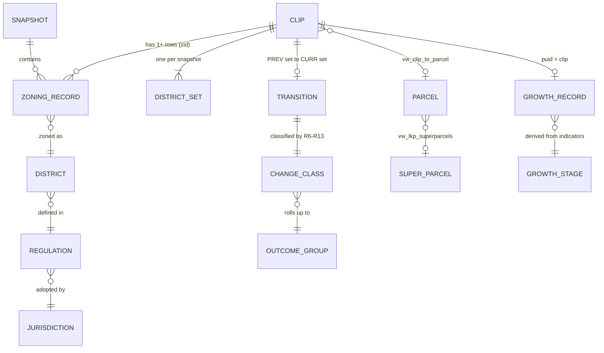

# Glossary (domain model)

The shared vocabulary for this repo. Use these terms in chats, docs, SQL comments, issues and PRs.

**Rules**
- Use the **canonical term** exactly as written here. Don't coin synonyms.
- Terms in the **Avoid** column are known aliases. Replace them, and check for them with `python3 .github/skills/domain-glossary/lint_glossary.py`.
- The **Code** column gives the exact column, label or table name. Where SQL and prose disagree, the latest SQL (zoning MVP) wins.
- Add or change terms on a branch through the issue workflow, using the `domain-glossary` skill. When renaming a term, move the old name into **Avoid**.

## Domain model

## Shared

| Term | Definition | Avoid | Code | Source |
|---|---|---|---|---|
| **CLIP** | Cotality's unique parcel identifier; the join key across all datasets. Write it in uppercase in prose. | `parcel ID`, `clip id` | `clip`; `puid` in growth tables | — |
| **Parcel** | The real-world piece of land a CLIP identifies. Say "parcel" for the land and "CLIP" for the identifier or row. A parcel can hold several CLIPs (condos); CLIP → parcel comes from `vw_clip_to_parcel`. | | `parcel_shape_id` | — |
| **FIPS** | 5-digit county code, zero-padded. | `county code` | `fips` = `LPAD(fips_code, 5, '0')` | R1 |
| **County** | Written as "<Name> <ST>", e.g. "Maricopa AZ". POC counties: Maricopa AZ (04013), Alachua FL (12001), Orange FL (12095). "Gainesville" is a city jurisdiction inside Alachua FL, not a county. | | `county` | zoning MVP |
| **Growth table** | The PanoramiQ growth indicators view, one row per CLIP. | `growth-table` | `vw_edr_panoramiq_growth_indicators`, `…_v2`; `is_growth_clip` | growth_intel, zoning MVP |
| **Growth Intelligence V1 / V2** | V1 = production indicator logic in the growth table; V2 = the revised logic proposed in `growth_intel/`. Uppercase **V**. | | suffix `_V2` | `growth_intel/` |
| **Zoning POC version** | Iterations of the zoning work: v1, v2, v4, v6, v6b, MVP. Lowercase **v**, so it doesn't collide with Growth Intelligence V1/V2. | | rule `Tag` column | `zoning_POC.md` |

## Zoning

### Data and entities

| Term | Definition | Avoid | Code | Source |
|---|---|---|---|---|
| **Gridics** | The zoning data vendor. | | `gridics_zoning*` | — |
| **Snapshot** | A dated copy of the Gridics zoning table. **PREV** = archive `gridics_zoning_archive_250903`; **CURR** = active `gridics_zoning`. | `old table`, `new table` | `prev_*`, `curr_*`, `prev_s`, `curr_s` | R1 |
| **Zoning record** | One row in a snapshot: a CLIP inside one vendor zone polygon. | | | R1 |
| **zid** | The vendor's zone polygon ID. It is renumbered on every reload, so never compare it across snapshots. | | `zid` | R3 |
| **District** | A zoning category code such as `R1` or `PD`. Always compared after normalization. | | `zoning_district`; normalized by `dcode()` | R2 |
| **District set** | A CLIP's sorted, de-duplicated, pipe-joined normalized districts in one snapshot, e.g. `C2\|R1`. | `zoning string` | `prev_dset`, `curr_dset` | R3 |
| **Split-zoned** | A CLIP whose district set contains more than one district. | `multi-district`, `multi-zoned`, `MULTI_DISTRICT` | `STRPOS(dset, '\|') > 0` | R3, R10 |
| **Regulation** | The named zoning code that defines districts, e.g. "Orange Code 2050". | `zoning code` | `zoning_regulation_name`; `prev_reg`, `curr_reg` | R8 |
| **Jurisdiction** | The county or city government that adopts a regulation. SQL approximates it as `(fips, regulation)`. | | | R8 |
| **Presence** | Whether a CLIP appears in both snapshots or only one. | | `presence` = `BOTH` / `ADDED` / `REMOVED` | R4 |
| **Coverage churn** | A CLIP in only one snapshot with no lineage parent. Counts as vendor coverage noise. | | | R4, R5 |
| **Parcel lineage** | The link from a child CLIP (created by a split) back to its parent CLIP. | | `lineage_parent_clip`, `is_split` *(planned)* | R5 |
| **Parcel essentials** | Cotality's parcel-level attribute table; the source of owner name and year built in the zoning MVP. Mostly one row per parcel, so the MVP dedupes it on `parcel_shape_id`. | | `parcel_essentials_dsf` | zoning MVP |
| **Owner name** | The parcel's primary owner name from parcel essentials. Condo CLIPs on one parcel share it. | | `owner_name` (from `ownr1fullname`) | zoning MVP |
| **Super parcel** | An assemblage of parcels with the same owner, all within 75 m of each other, found by DBSCAN clustering in Cotality's property graph. Marketing documentation calls it **Parcel Link**; BigQuery tables use "super parcels". A parcel belongs to at most one super parcel. Not the same as several CLIPs on one parcel (`n_clips_on_parcel`). | | `is_super_parcel`, `sp_id`; `vw_lkp_superparcels` | zoning MVP |
| **Super parcel owner name** | The super parcel's owner from `vw_superparcels`. Kept separate from **Owner name** (parcel essentials). | | `sp_owner_name` (from `owner`) | zoning MVP |

### Pipeline concepts

| Term | Definition | Avoid | Code | Source |
|---|---|---|---|---|
| **Transition** | The pair PREV district set → CURR district set for a CLIP. | `change pair` | `transition`, `same_tr` | R7, R12 |
| **District change** | A CLIP whose district set differs between snapshots. This is the gate into classification. | | `prev_dset IS DISTINCT FROM curr_dset` | R7 |
| **Rule-value change** | A change to height, FAR, density, setbacks etc. with no district change. Out of scope for this indicator. | | v1 labels `RULES_CHANGED` etc. | R7 |
| **Zoning assigned / dropped** | The CLIP is in both snapshots, but its district set is empty on one side. | | `ZONING_ASSIGNED`, `ZONING_DROPPED` | R6 |
| **Code regime switch** | A jurisdiction's whole regulation was replaced, so its district changes can't be measured this period. | `regime change` | `CODE_REGIME_SWITCH`; `reg_n`, `reg_chg_share` | R8 |
| **Rename or merge** | A jurisdiction renamed or merged districts (e.g. `RSF1`–`RSF4` → `SF`). It is learned as a crosswalk. | `DISTRICT_RENAME_OR_MERGE` | `RENAME_OR_MERGE`; `rename_map`, `prev_dset_mapped` | R9 |
| **Rezoning candidate** | A district change that survived the noise filters R8–R10. | `REZONE_CANDIDATE`, `rezone candidate` | `stage1 = 'CANDIDATE'` | R8–R10 |
| **Sliver** | A split-zoned CLIP lost a district at a boundary (CURR set ⊂ PREV set). Counts as noise. | | `SLIVER_DROP` | R10 |
| **Partial rezoning** | A split-zoned CLIP gained a district (PREV set ⊂ CURR set). It continues through the pipeline. | | `is_partial_rezone` | R10 |
| **City program** | A city-led remap into new districts that looks like scattered rezonings. | | `CITY_PROGRAM`; `is_city_program`, `tgt_is_new_district`, `tgt_n_src` | R11 |
| **Places** | Distinct 300 m DBSCAN clusters that a target district was handed out in. | `tgt_n_clusters` | `tgt_n_places` | R11 |
| **Rural source share** | The share of a target district's rezonings that came from AG/rural districts. | `tgt_ag_src_share` | `tgt_rural_src_share` | R11 |
| **kNN isolation** | The share of a candidate's k nearest sites that made the same transition. Co-located sites (condos) are excluded. | `k20_same_tr` | `k_n`, `k_same_tr`, `k_same_tr_share`, `n_colocated` | R12 |
| **Tract size** | The number of same-transition CLIPs within the search radius. | `n_same_tr_1km` | `n_same_tr_radius` | R13 |
| **Regulation move** | Observed: a CLIP's regulation differs between PREV and CURR. | | `is_reg_move` | R14 |
| **Annexation** | Confirmed subset of regulation moves: county regulation → city regulation. Not yet implemented. | | `is_annexation` *(reserved)* | R14 |
| **Use class** | A broad keyword-based use category for a district (CONS, AG, SF, MF, MU, COM, IND). | | `prev_use_class`, `curr_use_class` | R15 |
| **Intensity direction** | Upzone / downzone / use change / unknown, measured from intensity values or inferred from use rank. | `up-zone`, `down-zone` | `intensity_direction` = `UPZONE` / `DOWNZONE` / `USE_CHANGE` / `UNKNOWN` | R15 |
| **Rezoning** | A real change to a parcel's district made by its jurisdiction. Use "rezone" only as a verb. | | | — |

### Change classes and outcome groups

| Term | Definition | Avoid | Code | Source |
|---|---|---|---|---|
| **Change class** | The final per-CLIP label from the pipeline. | `bucket`, `buckets`, `change_class` | `zoning_change_class` | zoning MVP |
| **Outcome group** | One of three roll-ups of change classes: **noise**, **government change**, **development signal**. | `cosmetic change`, `jurisdiction-wide`, `district-wide`, `area rezoning`, `code-wide change` | | `zoning_POC.md` §1 |
| **Noise** | Outcome group: vendor or data artifacts. | | | §1 |
| **Government change** | Outcome group: changes made by a government or applied code-wide. | | | §1 |
| **Development signal** | Outcome group: rezonings a developer probably pursued; the product target. Contains `NEEDLE_PARCEL` + `SMALL_TRACT`. | | | §1 |
| **Needle** | Only an isolated single-parcel rezoning (`NEEDLE_PARCEL`). Not a synonym for development signal. | | `NEEDLE_PARCEL` | R12 |
| **Small tract** | A developer-scale group of same-transition CLIPs. | | `SMALL_TRACT` | R13 |
| **Mass change** | A same-transition change too large to be a developer tract. | | `MASS_CHANGE` | R13 |

Change class → outcome group:

| `zoning_change_class` | Rule | Outcome group |
|---|---|---|
| `SLIVER_DROP` | R10 | Noise |
| `NO_COORDS` | — | Unscored (no geometry) |
| `CODE_REGIME_SWITCH` | R8 | Government change |
| `RENAME_OR_MERGE` | R9 | Government change |
| `CITY_PROGRAM` | R11 | Government change |
| `MASS_CHANGE` | R13 | Government change |
| `NEEDLE_PARCEL` | R12 | Development signal |
| `SMALL_TRACT` | R13 | Development signal |
| `ZONING_ASSIGNED` / `ZONING_DROPPED` | R6 | Open item (v2 only, not grouped) |

## Growth Intel

| Term | Definition | Avoid | Code | Source |
|---|---|---|---|---|
| **Base table** | The per-CLIP analysis table built by `base_table.sql`, which the V2 indicators read. | | `growth_intelligence_base_qgis` | `base_table.sql` |
| **Growth stage** | The per-CLIP stage derived from indicators: **Early Growth**, **Ongoing Growth**, **Recently Completed**. V1 also had a **New Clip** stage; V2 folds new CLIPs into Early Growth. | | `growth_stage`, `growth_stage_V2` | `V2_indicators.sql` |
| **Indicator** | A Y/N flag per CLIP that feeds the growth stage. | | `*_indicator`, `*_indicator_V2` | — |
| **Land use change indicator** | The land use code changed. Feeds Early Growth. | | `landuse_change_indicator`, `land_use_change_indicator_V2` | README |
| **Builder/developer ownership indicator** | The CLIP is owned by a builder or developer. Feeds Early Growth. | `builder developer` | `builder_developer_ownership_indicator`, `…_V2` | README |
| **New CLIP indicator** | The CLIP was newly created. Feeds Early Growth in V2. | | `new_clip_indicator`, `new_clip_indicator_V2` | README |
| **New construction permit indicator** | A recent new-construction building permit exists. Feeds Ongoing Growth. | | `recent_new_con_bldg_permit_indicator`, `…_V2` | README |
| **Recent year built indicator** | Year built is recent. Feeds Recently Completed. | | `recent_yearbuilt_indicator` | `base_table.sql` |
| **Recent new construction sale indicator** | A recent sale of new construction exists. Feeds Recently Completed. | | `recent_new_construction_sale_indicator` | `base_table.sql` |
| **Year built** | The latest actual year built, falling back to the latest effective year built. | | `max_yr_built` = `COALESCE(latest_year_built, latest_eff_year_built)` (from `yybltactdt`, `yyblteffdt`) | `base_table.sql`, zoning MVP (from parcel essentials) |
| **Vacant** | The CLIP has vacant delivery points. **Occupied** = not vacant (ratio 0 or NULL). | | `addr_vacant_ratio > 0` | `base_table.sql` |
| **Latest sale date** | The most recent recorded transaction for the CLIP. | | `max_transaction_date` (from `recordingdt`) | `V2_indicators.sql` |
| **Number of structures** | Count of buildings on the CLIP. | | `num_structures` *(proposed)* | README |
