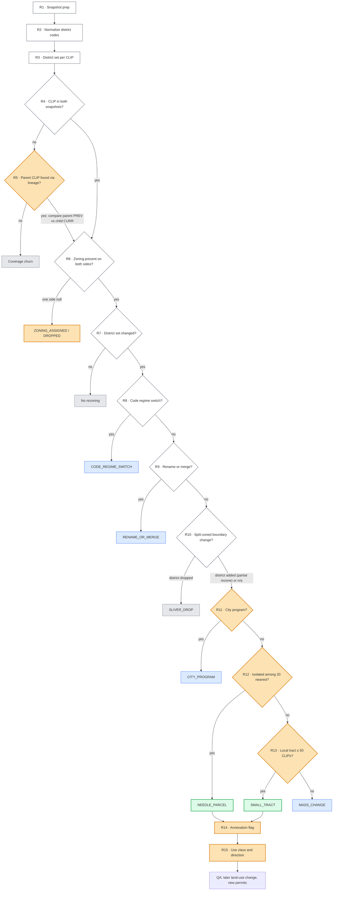
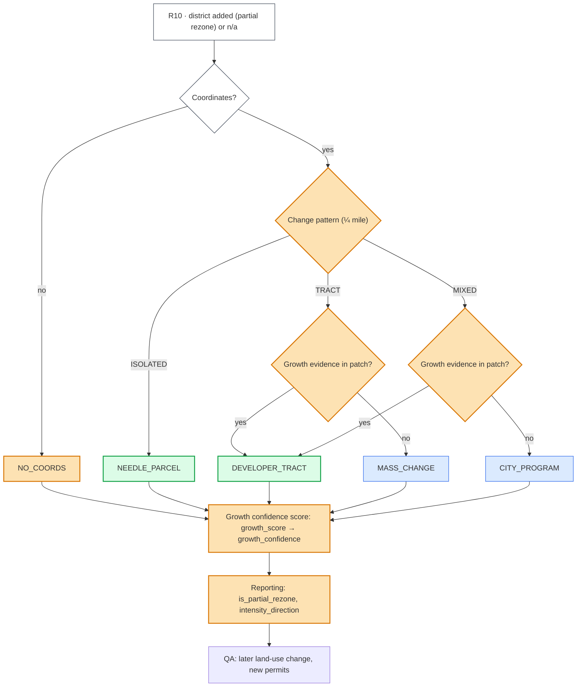

# Zoning Change Indicator: POC notes

**Goal:** find parcel rezonings that a developer probably pursued ("needles in the haystack"). Separate them from vendor and data noise, and from government or code-wide changes.

**Data:** Gridics zoning, two snapshots joined on `clip`.
- **PREV:** `clgx-idap-bigquery-prd-a990.edr_ent_property_zoning_hist.gridics_zoning_archive_250903`
- **CURR:** the active table.

**POC counties:** Maricopa AZ (04013), Alachua FL (12001, Gainesville only) and Orange FL (12095).

**Versions:**
- **MVP1** (`zoning_change_mvp1.sql`, frozen in #32): R1–R13, with R14 / R15 as enrichment.
- **MVP2** (`zoning_change_mvp2.sql`, #26):
  - copies R1–R10 unchanged;
  - replaces R11–R13 with the growth-signal steps (change pattern, growth evidence, growth confidence score).
- The two are built independently and compared by joining their outputs on `clip` (#33).

## 1. Decision flow

**Legend**
- ⬜ **White:** built rule.
- 🟧 **Orange:** open item (a new data source, a draft rule, or a threshold that still needs QA).
- Outcome boxes:
  - **Grey:** vendor or data noise.
  - 🟦 **Blue:** government or code-wide change.
  - 🟩 **Green:** development signal.

Rule IDs (`R1`–`R15`) and the named MVP2 steps match the table in section 2. MVP2's steps have no R-number on purpose: they are named by what they compute, and their inputs by their variable names.

### MVP1 flow



### MVP2 flow (after R10)
R1–R10 are the same as in MVP1. Every rezoning candidate that leaves R10 is classified and gets a growth confidence score.



## 2. Rules

| # | Pipeline step | Rule | Problem it solves | Tag | POC impact | Implementation |
|---|---|---|---|---|---|---|
| R1 | Ingestion | Snapshot prep | Keep only valid, comparable records | v1 | n/a | • FIPS filter (`LPAD(fips_code,5,'0')`)<br/>• `clip IS NOT NULL`<br/>• drop `clgx_pmd_actionflag = 'D'` |
| R2 | Cleaning | Normalize district codes | Formatting-only differences (`PD` vs `P-D`) | v1/v2 | Up to ~27% of Orange CLIPs (~118K CLIPs in `PD`, to be verified); other counties TBD<br/>*e.g. Orange `PD` → `P-D`* | • strip non-alphanumerics<br/>• uppercase<br/>• **TBD:** `RSTD*` vs `RESTRICTED*` prefixes |
| R3 | Cleaning | District set per CLIP | Split-zoned parcels and multiple vendor `zid`s | v2 | ~1% of CLIPs have more than one row<br/>*e.g. `R1` (zid 55) + `C2` (zid 91) → `C2\|R1`* | • distinct normalized codes per CLIP<br/>• sorted and joined with a pipe (`\|`)<br/>• `zid` ignored |
| R4 | Matching | CLIP match | Parcels in only one snapshot | v1 | National: 41.5M → 52.3M distinct CLIPs<br/>*e.g. vendor coverage grew from 487 to 629 counties* | • full outer join on `clip`<br/>• `presence` = BOTH / ADDED / REMOVED |
| R5 | Matching | Parcel lineage | Rezoned and then subdivided parcels get new CLIPs | NEW | Unknown<br/>*e.g. an `AG` parent CLIP split into 40 new `RSL30` lots* (hypothetical) | • **TBD:** parent-CLIP lookup for ADDED CLIPs<br/>• **TBD:** compare parent PREV vs child CURR |
| R6 | Filtering | Zoning coverage | Parcel in both snapshots but zoning blank in one | v2 | 0.07% (Maricopa), 0.42% (Gainesville), 0.20% (Orange)<br/>*e.g. Maricopa: 679 assigned (∅ → district), 527 dropped (district → ∅)* | • one side NULL → `ZONING_ASSIGNED` / `ZONING_DROPPED`<br/>• **TBD:** annexation vs vendor coverage |
| R7 | Filtering | District set change | Gate: only district changes can be rezonings | v2 | Orange ≥62%, Gainesville ≥51%, Maricopa <1% of CLIPs pass<br/>*e.g. passes: `R1` → `PD`; stops: `R1` → `R1` with height 35 → 30* | • `prev_dset ≠ curr_dset` |
| R8 | Noise classification | Code regime switch | The vendor or a jurisdiction swapped the whole zoning code | v2 | 62% of Orange (~267K CLIPs)<br/>*e.g. regulation "Orange Code 2050" → "Chapter 38 - ZONING", districts `T32` → `R1AC`* | • regulation name changed<br/>• ≥50% of the regulation's CLIPs changed district<br/>• ≥20 CLIPs in the regulation<br/>• **TBD:** handling for jurisdictions that aren't measurable |
| R9 | Noise classification | Rename/merge crosswalk | Jurisdiction renamed or merged districts | v2/v6b | 51% of Gainesville (~18.5K CLIPs)<br/>*e.g. `RSF1`/`RSF2`/`RSF3`/`RSF4` → `SF`; split-zoned `PD\|RSF1` → `PD\|SF`* | • learned from single-district CLIPs per (county, regulation, district)<br/>• top target share ≥0.9<br/>• ≥20 CLIPs<br/>• map applied to each district in split-zoned sets *(drafted, not run)* |
| R10 | Noise classification | Split-boundary handling | Split-zoned parcel lost a district (boundary noise) vs gained one (possible partial rezone) | v2/v6b | Split-boundary cases among needles: Orange 466 of 520, Maricopa 201 of 621, Gainesville 11 of 64<br/>*e.g. lost: `T43\|T52` → `T52`; gained: `CAN` → `CAN\|PD`* | • after set contained in before set (district lost) → `SLIVER_DROP` *(drafted, not run)*<br/>• before set contained in after set (district gained) → `is_partial_rezone` *(drafted, not run)*<br/>• **TBD:** gained district already on neighboring parcels → sliver (e.g. `RU43` → `RU190\|RU43`) |
| R11 | Noise classification | City program (MVP1) | City-led remap that looks like scattered rezonings | v6b · MVP1 | MVP1: 123 CLIPs (Maricopa AZ), 4 CLIPs (Alachua FL)<br/>*e.g. Mesa form-based code `DC` → `T6MS`* | • rezoning candidates only, grouped per target (`fips`, `curr_reg`, `curr_dset`)<br/>• new district: single district not in any PREV district set in the county; planned-development codes exempt<br/>• or ≥4 source district sets, ≥10 places (300 m), <50% from rural districts<br/>• **TBD:** misses compact remaps (Mesa transect districts) and flags scattered developer rezonings (Mesa `RM4`); redesign in #26 |
| R12 | Spatial scoring | kNN isolation (MVP1) | Separate single-parcel rezonings from neighborhood-wide changes | v6 · MVP1 | Maricopa 621 / Gainesville 64 / Orange 520 needles<br/>*e.g. Maricopa `AG` → `LI`, Gainesville `BUS` → `U8`, Orange `CAN` → `PD`* | • 20 nearest sites within 1 km<br/>• co-located sites (condos) excluded<br/>• ≤15% share the same transition → `NEEDLE_PARCEL`<br/>• **TBD:** thresholds via QA |
| R13 | Spatial scoring | Tract size (MVP1) | Developer tract vs mass change | v6 · MVP1 | Maricopa: 700 small-tract / 1,677 mass<br/>*e.g. tract: `AG` → `RSL30` (42); mass: `PAD` → `R14` (304)* | • ≤50 same-transition CLIPs within 1 km → `SMALL_TRACT`<br/>• else `MASS_CHANGE`<br/>• **TBD:** threshold via QA |
| — | Growth signal | Change pattern (MVP2) | Is the rezoning isolated, part of a same-transition tract, or inside a mixed remap? Shares only, no code lists or fixed counts | MVP2 | Not run yet (#30)<br/>*e.g. Mesa `DC` → `T4N` among ~265 other rezoning candidates, 3% with the same transition → `MIXED`* | • ¼-mile neighborhood, co-located CLIPs excluded<br/>• `qmi_cand_share` ≤ 0.05 → `ISOLATED` → `NEEDLE_PARCEL`<br/>• else `qmi_same_tr_share` ≥ 0.5 → `TRACT`<br/>• else `MIXED` |
| — | Growth signal | Growth evidence (MVP2) | Developer tract vs government change, from ownership and year built instead of tract size | MVP2 | Not run yet (#30)<br/>*e.g. `RS43` → `RSL30` (97 CLIPs, no year built) → `DEVELOPER_TRACT`; Mesa `RM2` → `T4N` (209 CLIPs, 189 owners, built 1915+) → `MASS_CHANGE`* | • per patch (same target district, linked within ¼ mile)<br/>• owner evidence: top owner or top super parcel ≥ 50% of the patch<br/>• land evidence: ≥ 75% with no year built or a recent year built<br/>• `TRACT` / `MIXED` with evidence → `DEVELOPER_TRACT`; without → `MASS_CHANGE` / `CITY_PROGRAM` |
| — | Growth signal | Growth confidence score (MVP2) | Rank every rezoning candidate by growth evidence, not only the development signal classes | MVP2 | Not run yet (#30) | • additive points → `growth_score`<br/>• `growth_confidence` = `HIGH` (≥ 3) / `MEDIUM` (1–2) / `LOW` (≤ 0)<br/>• `growth_score_inputs` lists the points |
| R14 | Enrichment | Annexation flag | County → city move, a developer signal | v6 | ~28 candidates (Maricopa 24, Orange 4)<br/>*e.g. regulation "Maricopa County Zoning Ordinance" → city code* | • `is_reg_move` = `prev_reg ≠ curr_reg` outside R8<br/>• MVP2: computed for every rezoning candidate; `is_reg_move` adds +1 to `growth_score`<br/>• **TBD:** explicit county→city mapping |
| R15 | Enrichment | Use class and direction | Up- vs downzone for QA and reporting | v2/v4 | Maricopa rezonings: 395 up / 107 down / 1,338 use change / 784 unknown<br/>*e.g. `AG` → `RS7` = inferred upzone (AG → single-family)* | • keyword-based use class<br/>• measured intensity direction, otherwise inferred from use rank<br/>• not in the MVP1 SQL; MVP2: `intensity_direction` is reporting only, not a `growth_score` input<br/>• **TBD:** fix transect codes misclassified as AG |

### R1. Snapshot prep `[v1]`
- **What:** keep valid records from each snapshot.
- **Why:** deleted or unkeyed records can't be compared.
- **Data columns:** `clip`, `fips_code`, `clgx_pmd_actionflag`.
- **Algorithm:**
  - `LPAD(fips_code,5,'0') IN (fips_list)`.
  - `clip IS NOT NULL`.
  - `clgx_pmd_actionflag != 'D'`.

### R2. Normalize district codes `[v1/v2]`
- **What:** compare district codes after stripping formatting.
- **Why:** punctuation and case differences look like rezonings (`PD` vs `P-D`).
- **Data columns:** `zoning_district`.
- **Algorithm:**
  - `dcode(x) = UPPER(REGEXP_REPLACE(x, r'[^A-Za-z0-9]', ''))`.
  - Applied before R3.

### R3. District set per CLIP `[v2]`
- **What:** a parcel's zoning is the sorted, de-duplicated set of all districts it falls in.
- **Why:** about 1% of CLIPs have several rows, either split-zoned (different districts) or with several `zid`s for one district. Picking one row per side creates false changes. The vendor `zid` is renumbered on reload, so it's excluded.
- **Data columns:** `zoning_district`. `zid` is deliberately ignored. Derived: `prev_dset`, `curr_dset`.
- **Algorithm:**
  - `STRING_AGG(DISTINCT dcode(zoning_district), '|' ORDER BY dcode(zoning_district))` per CLIP.
  - `DISTINCT` collapses duplicate `zid`s; `ORDER BY` makes `R1|C2` and `C2|R1` the same.

### R4. CLIP match `[v1]`
- **What:** pair parcels across snapshots on `clip`.
- **Why:** most parcels found in only one snapshot come from wider vendor coverage, not zoning change.
- **Data columns:** `clip`. Derived: `presence` = `BOTH` / `ADDED` / `REMOVED`.
- **Algorithm:**
  - Full outer join PREV and CURR on `clip`.
  - `BOTH` continues to R6; the others go to R5.

### R5. Parcel lineage `[NEW]`
- **What:** link new CLIPs to the parent CLIP they were split from.
- **Why:** developers often rezone and then subdivide. The new lots get new CLIPs, so R4 misses exactly the rezonings we want most.
- **Data columns:** Cotality parcel lineage (parent CLIP → child CLIP). Derived: `lineage_parent_clip`, `is_split`.
- **Algorithm:**
  - For `ADDED` CLIPs, look up the parent.
  - Use the parent's PREV district set against the child's CURR set, then continue at R6.
  - Without a parent, the CLIP is coverage churn.

### R6. Zoning coverage `[v2]`
- **What:** the parcel exists in both snapshots, but zoning is blank in one.
- **Why:** usually vendor coverage; sometimes a real annexation or newly zoned land.
- **Data columns:** `prev_dset`, `curr_dset`.
- **Algorithm:**
  - One side NULL → `ZONING_ASSIGNED` / `ZONING_DROPPED`.
  - **Open:** tell annexation apart from vendor coverage.

### R7. District set change `[v2]`
- **What:** the core gate: did the normalized district set change?
- **Why:** only a district change can be a rezoning. Rule-value changes (height, setbacks, density) are out of scope for this indicator.
- **Data columns:** `prev_dset`, `curr_dset`.
- **Algorithm:** `prev_dset IS DISTINCT FROM curr_dset`.

### R8. Code regime switch `[v2]`
- **What:** detect when a jurisdiction's whole zoning code was swapped.
- **Why:** Orange PREV used "Orange Code 2050" (transect districts), while CURR uses "Chapter 38" (legacy districts). That produced about 267K "changes"; only 56 were real rezonings.
- **Data columns:** `zoning_regulation_name` (`prev_reg`, `curr_reg`). Derived: `reg_n`, `reg_district_chg_share`.
- **Algorithm:**
  - Per `(fips, prev_reg)`, flag a switch when all of these hold:
    - `prev_reg != curr_reg`;
    - `reg_district_chg_share >= 0.5`;
    - `reg_n >= 20`.
  - Rezonings inside a switched jurisdiction can't be measured this period.

### R9. Rename/merge crosswalk `[v2/v6b]`
- **What:** learn which old district maps to which new one across a jurisdiction.
- **Why:** Gainesville merged RSF1–4 into SF (~18.5K CLIPs).
- **Data columns:** `prev_dset`, `curr_dset`, `prev_reg`. Derived: `rename_map`, `prev_dset_mapped`.
- **Algorithm:**
  - From single-district CLIPs, per `(fips, prev_reg, prev_dset)`: it's a rename if the top target's share is ≥ 0.9 and n ≥ 20.
  - Apply the map to each element of split-zoned sets, which catches `PD|RSF1 → PD|SF`.

### R10. Split-boundary handling `[v2/v6b]`
- **What:** interpret changes in split-zoned sets.
- **Why:** a dropped district is usually a boundary sliver (`T43|T52 → T52`); an added district is a partial rezoning (`CAN → CAN|PD`).
- **Data columns:** `prev_dset_mapped`, `curr_dset`. Derived: `is_sliver_drop`, `is_partial_rezone`.
- **Algorithm:**
  - curr ⊂ prev → `SLIVER_DROP`.
  - prev ⊂ curr → `is_partial_rezone = TRUE`, and the parcel continues.
  - Anything else continues.

### R11. City program `[v6b · MVP1]`
- **What:** detect city-led remaps that look like scattered rezonings.
- **Why:** Mesa's form-based code moved old districts to transect districts across many blocks (`DR2 → T3N`, `RM2 → T4N`, `DC → T6MS`). A city program can touch a few lots here and there, so each lot looks isolated. R11 runs before R12 so that these are not labelled needles.
- **Input:** rezoning candidates (`stage1 = 'CANDIDATE'`) after R10.
- **Data columns:** `fips`, `curr_reg`, `curr_dset`, `prev_dset`, `geog`. Derived: `tgt_is_new_district`, `tgt_n_src`, `tgt_n_places`, `tgt_rural_src_share`, `is_city_program`.
- **Algorithm:** a target is one (`fips`, `curr_reg`, `curr_dset`). Every candidate moving into a target is `CITY_PROGRAM` if either test passes:
  - **New district** (`tgt_is_new_district`), all of:
    - `curr_dset` is a single district (no `|`);
    - it is not in any PREV district set in the county, across all regulations (`prev_universe`);
    - it is not a planned-development code (`^(PD|PAD|PUD|PCD|PDD)`), because developers get new ones routinely.
  - **Handed out widely**, all of:
    - ≥ `prog_min_src` (4) distinct PREV district sets (`tgt_n_src`);
    - ≥ `prog_min_places` (10) places (`tgt_n_places`): DBSCAN clusters with `eps` 300 m and `minPts` 1, so candidates within 300 m count as one place;
    - < `prog_max_rural` (50%) of candidates have a rural district in their PREV set (`tgt_rural_src_share`, via `is_rural()`: `AG*`, `A<n>`, `AR`, `RA`, `RU<n>` e.g. `RU43`, `RURAL*`).
  - Candidates without coordinates are left out of the "handed out widely" stats, but they still take their target's result.
- **Diagnostics:** S5 (per-target stats and resulting change class) and S6 (sensitivity to `prog_min_places`) in `zoning_change_mvp1.sql`.
- **Known problems (#9, from S5 on Maricopa AZ):**
  - False positive: Mesa `RM4` is the only target that passes "handed out widely" (17 places, 1.9 CLIPs per place, 18 owners for 34 CLIPs). Labelled true positives sit in it (`NC → RM4`, `RS43 → RM4`, `RM2 → RM4`), so these are separate developer rezonings.
  - Misses: Mesa's transect districts (`T3N`, `T4N`, `T4NF`, `T4MS`, `T5MS`, `T5MSF`, `T5N`) existed in PREV and form only 1–5 places (17–140 CLIPs per place), so both tests fail. About 451 of their CLIPs land in `NEEDLE_PARCEL` / `SMALL_TRACT`. R12 doesn't catch them either: neighbours came from different source districts, so they don't share a transition.
  - The thresholds are fixed counts that don't scale with county size, and the rural and planned-development code lists are based on Arizona and Florida codes.
- **Next:** thresholds were left unchanged, and MVP1 is frozen with them. MVP2 replaces R11–R13 with the growth-signal steps (see "MVP2: growth signal" below).

### R12. kNN isolation `[v6 · MVP1]`
- **What:** check whether a candidate's neighbors made the same change.
- **Why:** Product definition: a developer-driven rezoning is isolated; a shared change is not.
- **Data columns:** `clip_latitude`, `clip_longitude`, transition (`prev_dset → curr_dset`). Derived: `n_colocated`, `k20_same_tr`.
- **Algorithm:**
  - Take the 20 nearest sites within 1 km, excluding sites at the same point (condos).
  - If ≤ 15% of them share the transition → `NEEDLE_PARCEL`.

### R13. Tract size `[v6 · MVP1]`
- **What:** decide whether a non-isolated change is a developer tract or a mass change.
- **Why:** developers often rezone whole tracts of 20–100 lots, which R12 alone would discard.
- **Data columns:** coordinates, transition. Derived: `n_same_tr_1km`.
- **Algorithm:**
  - Same-transition CLIPs within 1 km ≤ 50 → `SMALL_TRACT`.
  - Otherwise → `MASS_CHANGE`.

### MVP2: growth signal (after R10) `[MVP2]`
After R10, the remaining rezoning candidates are real district changes. These steps decide which of them signal real-estate growth, meaning something is being built or will be built soon. In MVP2 they replace R11–R13 (#26); MVP1 keeps R11–R13 unchanged.
- **Design rules (user, 2026-11-11):**
  - No code lists and no fixed counts. That means no `is_rural()`, no planned-development regex and no `prog_min_*`.
  - Use generic signals plus our own data: spatial proximity, shares of nearby changed parcels, ownership and super parcels, and year built relative to PREV.
  - The steps are named, not numbered. Each input is referred to by its variable name.
- **Input:** every rezoning candidate (`stage1 = 'CANDIDATE'`), including partial rezonings (`is_partial_rezone`).
- **Not scored:** `CODE_REGIME_SWITCH`, `RENAME_OR_MERGE`, `SLIVER_DROP`, `ZONING_ASSIGNED` / `ZONING_DROPPED`.
- **Order:** features (#29) → change pattern → growth evidence → change class → growth confidence score (#30), all in `zoning_change_mvp2.sql`, writing `zoning_change_mvp2`.

#### Features `[MVP2, #29]`
One row per rezoning candidate, built in a temp table before the gates.
- **Quarter-mile neighborhood:** all CLIPs within 402.336 m (`qmi_m`, ¼ mile) of the candidate.
  - **Site:** a CLIP in `j`, i.e. in both snapshots with zoning on both sides, changed or not.
  - **Co-located:** a CLIP within 1 m of the candidate, typically a condo on the same parcel. Co-located CLIPs are excluded from the `qmi_*` counts and shares, as in MVP1's R12.
- **Patch:** rezoning candidates with coordinates and the same target district set (`curr_dset`) that are linked within ¼ mile, whatever their source district:
  - `ST_CLUSTERDBSCAN(geog, qmi_m, 1) OVER (PARTITION BY fips, curr_dset)`;
  - keyed on the target, not the full transition, so a subdivision whose lots came from different districts (e.g. `AG` → `RSL30` and `LC` → `RSL30`) forms one patch;
  - co-located CLIPs are included.
- **Patch owner:** today's owner (`owner_name`). Owner as of PREV would be better but isn't in `parcel_essentials_dsf`; see Backlog under Open items.

| Feature | Definition | Source | Neighbor set | Needs PREV? |
|---|---|---|---|---|
| `qmi_n_sites` | Sites within ¼ mile, excluding the candidate and co-located CLIPs | `j` | ¼ mile | No |
| `qmi_n_colocated` | CLIPs in `j` within 1 m of the candidate | `j` | 1 m | No |
| `qmi_n_cand` | Rezoning candidates of any transition within ¼ mile, excluding the candidate and co-located CLIPs | `chg` (`stage1 = 'CANDIDATE'`) | ¼ mile | No |
| `qmi_n_same_tr` | Those of `qmi_n_cand` with the candidate's transition | `chg` | ¼ mile | No |
| `qmi_cand_share` | **Candidate share:** `qmi_n_cand / qmi_n_sites`; 0 when `qmi_n_sites = 0` | derived | ¼ mile | No |
| `qmi_same_tr_share` | **Same-transition share:** `qmi_n_same_tr / qmi_n_cand`; NULL when `qmi_n_cand = 0` | derived | ¼ mile | No |
| `patch_id`, `patch_n` | Patch ID and its number of CLIPs, including the candidate | `chg` | patch | No |
| `patch_top_owner_share` | **Top-owner share:** CLIPs held by the patch's most common patch owner / `patch_n`. NULL owners don't count | parcel essentials (`owner_name`) | patch | No (today's owner) |
| `patch_top_sp_share` | **Top super parcel share:** CLIPs in the patch's most common `sp_id` / `patch_n` | `vw_lkp_superparcels` | patch | No (current super parcels) |
| `yb_status` | **Year-built status**, see below | parcel essentials (`max_yr_built`) | CLIP | Yes (PREV year) |
| `patch_growth_yb_share` | Patch CLIPs with `yb_status` `NO_YEAR_BUILT` or `RECENT` / patch CLIPs with `yb_status ≠ 'UNMATCHED'`; NULL when none match | derived | patch | Yes |
| `is_reg_move` | Existing: `prev_reg ≠ curr_reg` | `chg` | CLIP | Yes (both snapshots) |
| `is_partial_rezone` | Existing (R10). Reported, no points | `chg` | CLIP | Yes (both snapshots) |

**Year-built status (`yb_status`).** PREV is `gridics_zoning_archive_250903`, so `prev_snapshot_date = 2025-09-03` and the PREV year is 2025.
- `UNMATCHED`: no parcel or no parcel essentials row for the CLIP. Today this is also a NULL `max_yr_built`, so #29 must keep it apart from `NO_YEAR_BUILT`.
- `NO_YEAR_BUILT`: the CLIP matched parcel essentials, but `max_yr_built` is NULL.
  - Treated as "no structure yet". Year built comes from county records, so expect false positives.
  - NULL can also be a missing year on a built parcel: up to 56% of a Mesa downtown patch is NULL among structures from the 1900s.
  - **Open:** review its +2 weight (see Open items).
  - Not the same as **Vacant** (`addr_vacant_ratio > 0`).
- `RECENT`: `max_yr_built ≥ EXTRACT(YEAR FROM prev_snapshot_date) − recent_yb_years`, with `recent_yb_years` = 2, so 2023 or later.
  - This covers growth realised after the rezoning, e.g. Longbow 2024.
  - In the dev MVP1 output, no Maricopa candidate has `max_yr_built ≥ 2025`, so "built after PREV" alone would be empty.
  - **To try later:** current year − 2 (2024) instead of PREV year − 2. Keep this as a comment next to the `DECLARE`.
- `OLD`: any other year.

#### Change pattern `[MVP2]`
- **What:** describe the shape of the change around the candidate, without growth evidence.
- **Why:** #26 found that the share of nearby changed parcels with the same transition is the best single split:
  - developer subdivisions: 0.73–1.0;
  - Mesa transect districts: 0.08–0.43;
  - the `DC` → `T4N` church (a false positive): 0.03.
  
  Isolated true positives, by contrast, mostly have few changed parcels nearby (0–11 within ¼ mile), whatever their share. Shares scale with density; fixed counts don't.
- **Mixed sources, one subdivision:** `LC` → `RSL30` (labelled true) has 42 rezoning candidates within ¼ mile, all `AG` → `RSL30` (one builder, no year built), and none with its own transition. Its change pattern stays `MIXED`, but because patches are keyed on the target district it joins the 43-CLIP `RSL30` patch, gets owner and land evidence, and becomes `DEVELOPER_TRACT` (+3, `HIGH`).
  - Keying the change pattern on the target district too was rejected: Mesa remaps send many source districts to the same transect district, so Maricopa AZ CLIPs with Mesa transect targets that count as `TRACT` would rise from 182 to 589, removing the `MIXED` penalty that catches the false positives.
- **Algorithm (`change_pattern`):**

  ```sql
  CASE
    WHEN geog IS NULL                                 THEN NULL         -- class NO_COORDS
    WHEN qmi_cand_share <= isolated_max_cand_share    THEN 'ISOLATED'   -- 0.05
    WHEN qmi_same_tr_share >= tract_min_same_tr_share THEN 'TRACT'      -- 0.5
    ELSE 'MIXED'
  END
  ```

#### Growth evidence `[MVP2]`
- **What:** decide whether a non-isolated change looks like a developer project or a government change.
- **Why:** this replaces MVP1's R13 50-CLIP tract cap, which sent `RS43` → `RSL30` (97 CLIPs, a labelled true positive) to `MASS_CHANGE`. Checks on same-transition patches in the dev MVP1 output (Maricopa AZ) show the split:
  - Developer patches have 82–100% no year built or recent year built, or one owner or super parcel holding most of the patch:
    - `PAD` → `R14` (Meritage, 0.83);
    - `AG` → `RS7` (0.99);
    - `AG` → `RSL30` (0.69).
  - Mesa transect patches have ≤ 56% no year built, a top-owner share ≤ 0.37, and structures from the 1900s.
  - Keying patches on the target district instead (Maricopa AZ rezoning candidates):
    - Mesa transect targets: CLIPs with land evidence 70 → 46, owner evidence 119 → 58 (bigger, more mixed patches);
    - other targets: land evidence 1,180 → 1,188, owner evidence unchanged at 874.
- **Algorithm:**
  - `has_owner_evidence = patch_n ≥ 2 AND (patch_top_owner_share ≥ owner_min_share OR patch_top_sp_share ≥ owner_min_share)`, with `owner_min_share` = 0.5.
  - `has_land_evidence = patch_n ≥ 2 AND patch_growth_yb_share ≥ land_min_share`, with `land_min_share` = 0.75.
  - A single-CLIP patch has no patch evidence: its top-owner share is trivially 1, and its year built is already scored per CLIP.
  - The patch owner is today's owner, so owner evidence weakens after homes sell: Landsea `RS43` → `RSL30` has a current top-owner share of 0.39 with 22 owners. It still gets land evidence (97 CLIPs with no year built). One project can also use several names, which is why the super parcel share counts as well.

#### Change class `[MVP2]`
```sql
CASE
  WHEN stage1 != 'CANDIDATE'                    THEN stage1
  WHEN geog IS NULL                             THEN 'NO_COORDS'
  WHEN change_pattern = 'ISOLATED'              THEN 'NEEDLE_PARCEL'
  WHEN has_owner_evidence OR has_land_evidence  THEN 'DEVELOPER_TRACT'
  WHEN change_pattern = 'TRACT'                 THEN 'MASS_CHANGE'
  ELSE                                               'CITY_PROGRAM'
END
```
- `DEVELOPER_TRACT` is MVP2's counterpart of MVP1's `SMALL_TRACT`; it is renamed because there is no size cap any more. It covers both `TRACT` and `MIXED` patterns with growth evidence, e.g. a master-planned community rezoned into several districts.
- `NEEDLE_PARCEL`, `MASS_CHANGE` and `CITY_PROGRAM` keep their MVP1 labels, but MVP2 defines them differently. In MVP2:
  - `CITY_PROGRAM` is a mixed remap without growth evidence; it no longer depends on new districts, source counts or rural codes;
  - `NEEDLE_PARCEL` uses the ¼-mile candidate share instead of the 20-nearest-sites share.
  
  Compare the versions on the `zoning_change_mvp1` / `zoning_change_mvp2` outputs (#33), not on labels alone.
- Outcome groups:
  - development signal = `NEEDLE_PARCEL`, `DEVELOPER_TRACT`;
  - government change = `CITY_PROGRAM`, `MASS_CHANGE`;
  - `NO_COORDS` stays ungrouped.

#### Growth confidence score `[MVP2]`
- **What:** a per-CLIP score and tier for every rezoning candidate, whatever its class.
- **Why:** the class alone loses useful cases, e.g. a lot with no year built inside a Mesa remap (labelled true). With 72 labels from one county, additive points and tiers are easier to defend than a fitted model.
- **Form:** additive points (`growth_score`, INT64) → tier (`growth_confidence`) → audit string (`growth_score_inputs`, e.g. `NO_YEAR_BUILT +2; TRACT +1; owner +1`).

| Input | Points |
|---|---|
| `yb_status` | `NO_YEAR_BUILT` +2, `RECENT` +2, `OLD` −1, `UNMATCHED` 0 |
| `change_pattern` | `ISOLATED` +2, `TRACT` +1, `MIXED` −1, NULL (`NO_COORDS`) 0 |
| `has_owner_evidence` | +1 |
| `has_land_evidence` | +1 |
| `is_reg_move` | +1 |
| `is_partial_rezone` | 0 (reported only) |
| `intensity_direction` | 0 (reporting only; not in the MVP1 SQL) |

- **Tiers:** `HIGH` if `growth_score ≥ score_high_min` (3); `MEDIUM` if `≥ score_medium_min` (1); else `LOW`. Range −2 to +7.
- **Hand check on the labels (Maricopa AZ, approximate until #29 builds the features):**
  - the 4 Mesa false positives (`OLD`, `MIXED`): −2, `LOW`;
  - `AG` → `RSL30` tract (no year built, `TRACT`, owner and land evidence): +5, `HIGH`;
  - `RS35` → `PS` needle (built 2024, `ISOLATED`): +4, `HIGH`;
  - `LC` → `RSL30` (no year built, `MIXED`, owner and land evidence from the `RSL30` patch): +3, `HIGH`;
  - lots with no year built inside the Mesa `T4NF` remap: +1, `MEDIUM`;
  - an isolated rezoning on an old structure (`OLD`, `ISOLATED`): +1, `MEDIUM`. An isolated change alone is a growth signal; old structures keep it out of `HIGH`.
- The weight of `NO_YEAR_BUILT` (+2) assumes it means "no structure"; county-sourced year built has errors, so this weight is an open item. Weights live in one `CASE` block; the tier cutoffs are `DECLARE`s.

#### Neighborhood choice
- **Now: a fixed ¼ mile, with shares and patches.**
  - It measures isolation directly.
  - Patches use the same scale.
  - #26's split was measured at ¼ mile.
  - It needs no fixed count.
- **Known limit:** rural circles hold few sites, so `qmi_cand_share` and `qmi_same_tr_share` rest on small numbers there.
- **Later, as we scale to rural areas: consider a k-based neighborhood** (k nearest rezoning candidates). The check on the 72 labels (dev MVP1 output, k = 10) found:
  - it gives every candidate the same support;
  - it can't see isolation: true needles have their 10th changed neighbor 0.5–2.2 km away, so a distance cap is needed anyway;
  - it separates the Mesa false positives less well: their k = 10 same-transition share is 0.4–0.7, against 0.03–0.26 at ¼ mile;
  - small tracts below k look mixed: `AG` → `GC` (4 CLIPs) scores 0.4.
  
  The likely next step is "both": a kNN share, with ¼ mile or the distance to the k-th neighbor for isolation.

#### MVP2 `DECLARE`s (#30)
| `DECLARE` | Default | Used by |
|---|---|---|
| `qmi_m` | 402.336 | features (¼ mile) |
| `prev_snapshot_date` | `DATE '2025-09-03'` | `yb_status` |
| `recent_yb_years` | 2 | `yb_status` (comment: try current year − 2) |
| `isolated_max_cand_share` | 0.05 | change pattern |
| `tract_min_same_tr_share` | 0.5 | change pattern |
| `owner_min_share` | 0.5 | growth evidence |
| `land_min_share` | 0.75 | growth evidence |
| `score_high_min` | 3 | growth confidence score |
| `score_medium_min` | 1 | growth confidence score |

#### MVP1 parts: copied unchanged vs left out
MVP2 is a full script of its own and doesn't read MVP1's tables (#32). From MVP1 (`zoning_change_mvp1.sql`) it:
- **Copies unchanged:**
  - **`DECLARE`s:** `fips_list`, `min_group_n`, `regime_chg_share`, `rename_share`.
  - **Helpers:** `dcode()`, `is_sub()`.
  - **R1–R4, R6–R10:** the temp tables `prev_s`, `curr_s`, `j` and `chg`, including `rename_map`, `prev_dset_mapped`, `stage1`, `is_partial_rezone` and `is_reg_move`. R5 isn't built in either version.
  - **Final-table joins:** `growth` (`is_growth_clip`), `c2p`, `pe` (`owner_name`, `max_yr_built`) and `sp` (`is_super_parcel`, `sp_id`, `sp_owner_name`).
  - **Diagnostics:** S1–S3.
- **Leaves out:**
  - **`DECLARE`s:** `prog_min_src`, `prog_min_places`, `prog_max_rural`, `radius_m`, `knn_k`, `needle_max_share`, `tract_max_clips`.
  - **Helpers and steps:** `is_rural()`, the planned-development regex `^(PD|PAD|PUD|PCD|PDD)`, the `prev_universe` CTE, the `prog` temp table (R11) and the `knn` temp table (R12/R13).
  - **Output columns:** `tgt_is_new_district`, `tgt_n_src`, `tgt_n_places`, `tgt_rural_src_share`, `k_n`, `k_same_tr`, `k_same_tr_share`, `n_colocated` (MVP2 has `qmi_n_colocated`), `n_same_tr_radius`.
  - **Diagnostics:** S5 and S6 (R11). S4 becomes change class × `is_super_parcel` × `growth_confidence`.
- **Adds:**
  - the features above;
  - `change_pattern`, `has_owner_evidence`, `has_land_evidence`;
  - `growth_score`, `growth_confidence`, `growth_score_inputs`;
  - the `DECLARE`s above.

#### Open items
- **#29:** keep `UNMATCHED` apart from `NO_YEAR_BUILT`.
- **`NO_YEAR_BUILT` weight:** +2 for now. Year built is county-sourced, so some `NO_YEAR_BUILT` CLIPs will have a structure. Review the +2 once results are in (#31 / #33).
- **Backlog (as we scale), #36:** owner as of PREV. `parcel_essentials_dsf` has only today's owner; an owner as of PREV can be sourced later and would replace `owner_name` as the patch owner.
- **#31:** tune the thresholds and weights against the labels. The 72 labels are all Maricopa AZ and were partly chosen on year built, so don't over-fit to them. Alachua FL needs labels.
- **#33:** compare MVP1 vs MVP2 classes and tiers per county.

### R14. Annexation flag `[v6]`
- **What:** flag candidates whose governing regulation changed, for example from county to city code.
- **Why:** annexation is usually developer-requested, so it's a strong signal.
- **Data columns:** `zoning_regulation_name`. Derived: `is_reg_move`, `is_annexation`.
- **Algorithm:**
  - Currently: `is_reg_move` = `prev_reg IS DISTINCT FROM curr_reg`, outside R8.
  - MVP2: computed for every rezoning candidate; `is_reg_move` adds +1 to the growth confidence score.
  - **Open:** map regulation names to jurisdiction types to detect county → city explicitly.

### R15. Use class and direction `[v2/v4]`
- **What:** label each district with a broad use class and give each candidate a direction (up- or downzone).
- **Why:** needed for QA and reporting. Intensity values are often missing, so direction is frequently inferred.
- **Data columns:** `zoning_district`, `zone_district_description`, `floor_area_ratio`, `maximum_building_height_feet`, `residential_density`. Derived: `prev_use_class`, `curr_use_class`, `direction`.
- **Algorithm:**
  - `use_class` is a keyword heuristic.
  - Direction is the measured intensity change if there is one. Otherwise it's inferred from the use rank (CONS < AG < SF < MF < MU/COM/IND), then `USE_CHANGE`, then `UNKNOWN`.
  - **Open:** transect codes (T3.x) are misclassified as AG.
  - Not in the MVP1 SQL. In MVP2, `intensity_direction` would be reported for every rezoning candidate but adds no growth confidence score points.

### QA signals (not rules)
Land-use changes and new permits usually *follow* a rezoning. They can confirm needles after the fact but can't detect them in the same period.

The MVP1 output also carries **owner name** (`owner_name`) and **year built** (`max_yr_built`) from parcel essentials, joined CLIP → parcel via `vw_clip_to_parcel` (one parcel per CLIP). They help QA development signals, e.g. a builder owner or a recent year built. In MVP1 they don't change any change class. In MVP2 they feed `yb_status`, the patch owner and growth evidence.

It also carries the **super parcel** flag (`is_super_parcel`), its ID (`sp_id`) and the **super parcel owner name** (`sp_owner_name`), joined parcel → `vw_lkp_superparcels` → `vw_superparcels` (one `sp_id` per parcel). The base tables `lkp_superparcels` / `superparcels` repeat keys, so use the views. In MVP1 these columns don't change any change class either. In MVP2, `sp_id` feeds `patch_top_sp_share`.

**Super parcel impact on R12/R13 (MVP1, assessment only).** A super parcel is same-owner parcels within 75 m, so an owner rezoning a whole assemblage gives several CLIPs the same transition within a few neighbours of each other. They count toward each other's `k_same_tr` (R12) and `n_same_tr_radius` (R13), which can push a single-owner change out of `NEEDLE_PARCEL` into `SMALL_TRACT`, or into `MASS_CHANGE` for very large assemblages. S4 in `zoning_change_mvp1.sql` reports `zoning_change_class` × `is_super_parcel` per county. Any change to R12/R13 logic is a separate issue.

  - **Findings (S4, MVP1 run for issue #8):** super parcel CLIPs are common in Maricopa AZ (1,394 of 3,285, 42%) and rare in Alachua FL (383 of 18,615, 2%, mostly `RENAME_OR_MERGE`). In Maricopa AZ they make up 30% of `NEEDLE_PARCEL`, 57% of `SMALL_TRACT` and 44% of `MASS_CHANGE`.
  - Their mean `n_same_tr_radius` is only slightly higher than for other CLIPs in `SMALL_TRACT` (24.6 vs 20.2) and `MASS_CHANGE` (145.9 vs 139.8), and lower in `NEEDLE_PARCEL` (9.8 vs 14.2). So super parcels don't visibly inflate R13 counts. Their over-representation in `SMALL_TRACT` fits R13's intent (developer assemblages).
  - **Open:** S4 can't show how many same-transition neighbours sit in the *same* super parcel. That needs a neighbour-level check on the `knn` step.